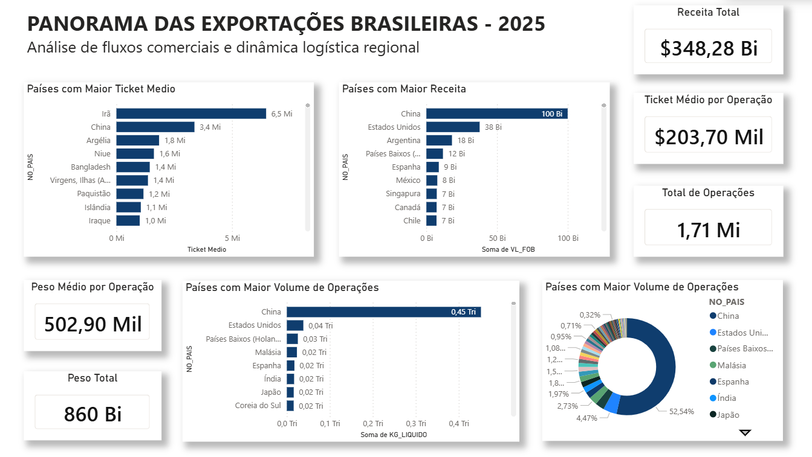
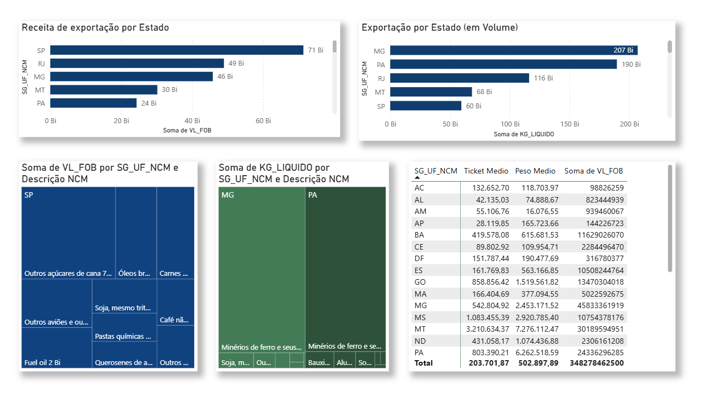
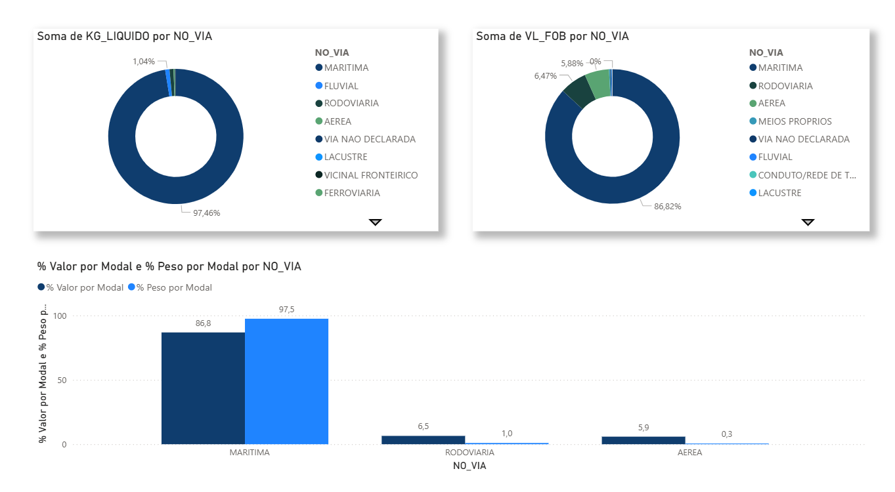

# Panorama das Exportações Brasileiras (2025)
### ETL com Power Query e Python, modelagem dimensional e dashboard no Power BI

Análise exploratória de aproximadamente **1,7 milhão de registros** de exportações brasileiras em 2025, com dados públicos do **Comex Stat**, do Ministério do Desenvolvimento, Indústria, Comércio e Serviços (MDIC).

O projeto combina preparação e validação de dados, modelagem dimensional e visualização para investigar a distribuição das exportações por unidade federativa, país de destino e modal de transporte.

## Navegação rápida

- [Notebook de ETL e validação](https://github.com/sofiajob/brazilian-exports-overview-2025/tree/main/notebooks)
- [Arquivos do dashboard Power BI](https://github.com/sofiajob/brazilian-exports-overview-2025/tree/main/dashboard)
- [Tabelas auxiliares](https://github.com/sofiajob/brazilian-exports-overview-2025/tree/main/tabelas_auxiliares)
- [Fonte oficial: Comex Stat](https://comexstat.mdic.gov.br/)

## Dashboard

O dashboard apresenta indicadores e comparações sobre as exportações brasileiras, com foco em visão geral, distribuição regional e modal de transporte.

## Principais insights

### 1. Especialização regional das exportações

| Unidade federativa | Valor exportado aproximado | Peso exportado aproximado | Leitura exploratória |
|---|---:|---:|---|
| São Paulo (SP) | US$ 71 bilhões | 60 bilhões de kg | Lidera em valor exportado e volume relativamente baixo no recorte analisado. Exportação de produtos industrializados e de alto valor agregado |
| Minas Gerais (MG) | US$ 46 bilhões | 207 bilhões de kg | Combina valor elevado com grande massa exportada. |
| Rio de Janeiro (RJ) | US$ 49 bilhões | 116 bilhões de kg | Ocupa a segunda posição em valor e a terceira em peso, com destaque para petróleo e derivados. |
| Pará (PA) | US$ 24 bilhões | 190 bilhões de kg | Commodities pesadas de baixo valor unitário, mas altíssimo peso. |

A comparação entre valor financeiro e peso evidencia perfis regionais distintos. Estados com grande massa exportada podem ter uma composição de produtos diferente daquela de estados que se destacam pelo valor total.

**Insight:** analisar valor e peso em conjunto ajuda a diferenciar a escala física dos fluxos comerciais do valor financeiro das mercadorias. A atribuição desse padrão a produtos específicos deve ser confirmada por uma análise da composição por NCM.

### 2. Modal aéreo: participação pequena no peso e maior no valor

No recorte analisado, o modal aéreo responde por aproximadamente **1% do peso total exportado**, mas por cerca de **6,5% do valor total**, equivalente a aproximadamente **US$ 23 bilhões**.

**Insight:** a diferença entre participação no peso e participação no valor é compatível com um perfil de mercadorias de maior valor financeiro por unidade de peso. Isso justifica investigar quais categorias de produtos utilizam o modal aéreo e como essa composição varia entre destinos. Os dados descritivos, sozinhos, não comprovam que o custo do frete seja compensado nem que exista viabilidade para ampliar esse modal.

### 3. Ticket médio por país de destino

A análise identificou os seguintes valores aproximados de ticket médio por operação:

| País | Ticket médio aproximado |
|---|---:|
| Irã | US$ 6,5 milhões |
| China | US$ 3,4 milhões |
| Argélia | US$ 1,8 milhão |

**Insight:** valores médios elevados podem decorrer de operações de grande valor ou de um número reduzido de registros. Por isso, o ticket médio deve ser interpretado junto do número de operações, da distribuição dos valores e da composição dos produtos; ele não representa necessariamente o valor típico de cada operação.

### 4. Concentração das exportações no mercado chinês

A China representa aproximadamente **30% do valor exportado** no recorte (cerca de **US$ 100 bilhões**) e **52,54% do peso exportado** (aproximadamente **0,45 trilhão de kg**).

**Insight:** a concentração em um destino comercial é um ponto de atenção para a análise de risco e exposição externa. A diferença entre a participação no valor e no peso também indica que a composição dos fluxos destinados à China merece investigação. Para afirmar dependência estrutural ou estimar o impacto de uma retração da demanda chinesa, seria necessário complementar esta análise com séries históricas, composição por produto e avaliação de mercados alternativos.

## Processo de dados

### 1. Extração

A tabela principal de exportações foi obtida a partir do Comex Stat, selecionando o ano de 2025 e o tipo de operação de exportação.

A tabela fato completa (`EXP_2025.csv`) não está versionada neste repositório devido ao seu tamanho. Ela deve ser obtida diretamente na fonte oficial.

### 2. ETL e validação no Power Query

Entre os tratamentos documentados estão:

**Ajuste do cabeçalho da dimensão de unidades federativas (`dim_uf`)**
- **Problema:** o cabeçalho estava na segunda linha do CSV.
- **Solução:** remoção da primeira linha e promoção da linha seguinte a cabeçalho.

**Preservação dos códigos NCM (`CO_NCM`)**
- **Problema:** códigos com zero à esquerda podiam ser convertidos incorretamente, por exemplo, `0101` para `101`.
- **Solução:** conversão da coluna para texto na tabela fato e na dimensão correspondente, preservando o identificador original.

Esses tratamentos são importantes porque códigos classificatórios devem ser preservados como identificadores, e não tratados como quantidades numéricas.

### 3. Modelagem dimensional - Star Schema

O modelo organiza as exportações em uma tabela fato relacionada a dimensões descritivas.

| Tabela dimensão (1) | Chave primária (PK) | Tabela fato (N) | Chave estrangeira (FK) |
|---|---|---|---|
| `dim_pais` | `CO_PAIS` | `fato_exportacoes` | `CO_PAIS` |
| `dim_uf` | `Sigla` | `fato_exportacoes` | `SG_UF_NCM` |
| `dim_ncm` | `Código NCM` | `fato_exportacoes` | `CO_NCM` |
| `dim_via` | `Via` | `fato_exportacoes` | `CO_VIA` |

Os relacionamentos são do tipo **1:N**: uma linha da dimensão pode estar associada a várias linhas da tabela fato. As chaves devem ter tipos e valores compatíveis entre as tabelas relacionadas.

### 4. Análise e visualização

As tabelas preparadas são utilizadas para comparar indicadores por estado, país de destino e modal de transporte. O Power BI oferece uma interface interativa para explorar os resultados por diferentes perspectivas.

## Ferramentas e competências demonstradas

| Ferramenta / técnica | Aplicação no projeto |
|---|---|
| Python | Apoio à preparação e análise dos dados |
| Power Query | Transformação, padronização e validação |
| Power BI | Indicadores, relacionamentos e visualização |
| Modelagem dimensional | Organização em tabela fato e dimensões |
| Análise exploratória | Comparação de métricas e identificação de padrões |

## Como reproduzir a análise

1. Acesse o [Comex Stat](https://comexstat.mdic.gov.br/).
2. Selecione o ano de 2025 e os dados de exportação necessários para reproduzir o recorte.
3. Utilize as tabelas auxiliares do diretório [`tabelas_auxiliares/`](https://github.com/sofiajob/brazilian-exports-overview-2025/tree/main/tabelas_auxiliares).

Os resultados podem variar caso a consulta, a disponibilidade dos dados ou os filtros usados na extração sejam diferentes.

## Fonte dos dados

Ministério do Desenvolvimento, Indústria, Comércio e Serviços (MDIC). **Comex Stat**: [https://comexstat.mdic.gov.br/](https://comexstat.mdic.gov.br/).

## Autoria

**Sofia Fernandes Job Junqueira**  
Projeto independente de análise, preparação, modelagem e visualização de dados.
