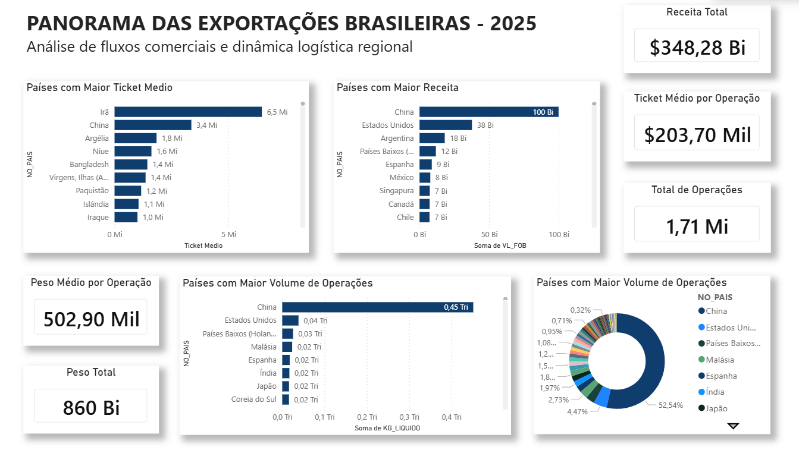
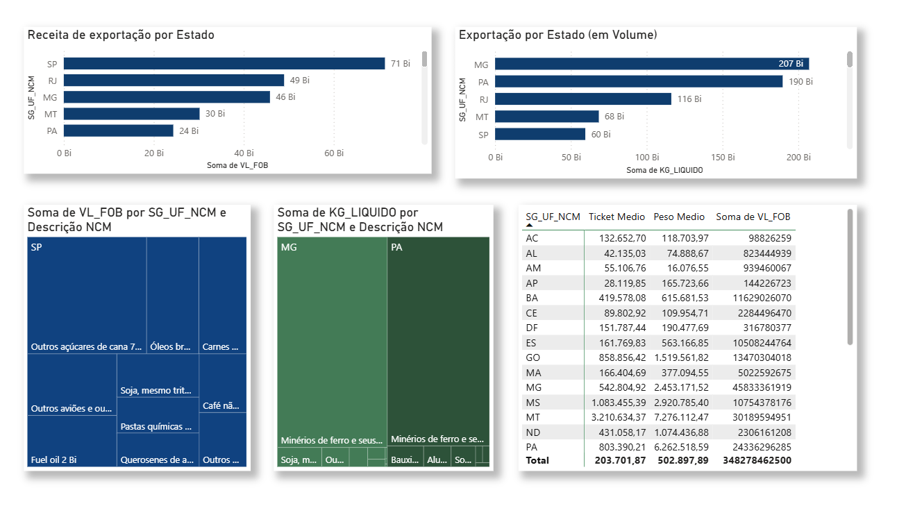
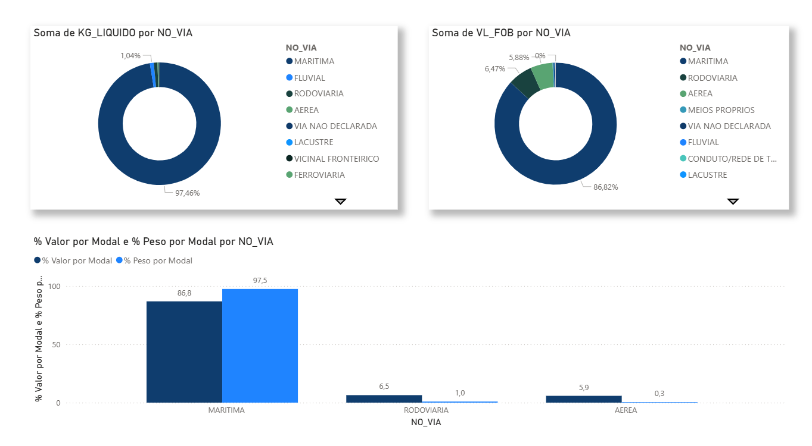

# Overview of Brazilian Exports (2025)
### ETL with Power Query and Python, Dimensional Modeling, and Power BI Dashboard

Exploratory analysis of approximately **1.7 million Brazilian export records** from 2025, using public data from **Comex Stat**, provided by Brazil's Ministry of Development, Industry, Trade and Services (MDIC).

The project combines data preparation and validation, dimensional modeling, and data visualization to investigate export distribution by Brazilian state, destination country, and mode of transport.

## Quick Navigation

- [ETL and Validation Notebook](https://github.com/sofiajob/brazilian-exports-overview-2025/tree/main/notebooks)
- [Power BI Dashboard Files](https://github.com/sofiajob/brazilian-exports-overview-2025/tree/main/dashboard)
- [Auxiliary Tables](https://github.com/sofiajob/brazilian-exports-overview-2025/tree/main/tabelas_auxiliares)
- [Official Data Source: Comex Stat](https://comexstat.mdic.gov.br/)

## Dashboard

The dashboard presents indicators and comparisons of Brazilian exports, focusing on an overview, regional distribution, and modes of transport.

## Key Insights

### 1. Regional Specialization in Exports

| Federative Unit | Approximate Export Value | Approximate Export Weight | Exploratory Interpretation |
|---|---:|---:|---|
| São Paulo (SP) | US$ 71 billion | 60 billion kg | Leads in export value despite a relatively low export volume in the analyzed dataset. Exports include manufactured and higher-value-added products. |
| Minas Gerais (MG) | US$ 46 billion | 207 billion kg | Combines high export value with a large physical export volume. |
| Rio de Janeiro (RJ) | US$ 49 billion | 116 billion kg | Ranks second in export value and third in weight, with a significant presence of oil and petroleum products. |
| Pará (PA) | US$ 24 billion | 190 billion kg | Exports heavy commodities with low unit values but very high physical weight. |

Comparing financial value and physical weight reveals distinct regional export profiles. States with large export volumes may have a different product composition from those that stand out in terms of total export value.

**Insight:** Analyzing export value and weight together helps distinguish the physical scale of trade flows from the financial value of goods. Attributing these patterns to specific products requires further investigation of product composition by NCM code.

### 2. Air Freight: Small Share of Weight, Larger Share of Value

In the analyzed dataset, air transport accounts for approximately **1% of total export weight**, but represents around **6.5% of total export value**, equivalent to approximately **US$ 23 billion**.

**Insight:** The difference between the shares of weight and value is consistent with a profile of goods with higher financial value per unit of weight. This justifies investigating which product categories use air transport and how this composition varies across destinations. Descriptive data alone cannot establish that freight costs are offset or that expanding the use of this transport mode is economically feasible.

### 3. Average Transaction Value by Destination Country

The analysis identified the following approximate average transaction values:

| Country | Approximate Average Transaction Value |
|---|---:|
| Iran | US$ 6.5 million |
| China | US$ 3.4 million |
| Algeria | US$ 1.8 million |

**Insight:** High average values may result from high-value transactions or a small number of records. Therefore, average transaction value should be interpreted alongside the number of transactions, the distribution of values, and product composition. It does not necessarily represent the typical value of an individual transaction.

### 4. Concentration of Exports in the Chinese Market

China accounts for approximately **30% of export value** in the analyzed dataset (around **US$ 100 billion**) and **52.54% of export weight** (approximately **0.45 trillion kg**).

**Insight:** Concentration in a single trading destination is an important consideration when analyzing external exposure and trade risk. The difference between China's shares of export value and weight also indicates that the composition of exports to this market deserves further investigation. Establishing structural dependence or estimating the impact of a decline in Chinese demand would require additional analysis using historical time series, product composition, and alternative markets.

## Data Workflow

### 1. Data Extraction

The main export table was obtained from Comex Stat by selecting the year 2025 and the export trade flow.

The complete fact table (`EXP_2025.csv`) is not version-controlled in this repository due to its size. It must be downloaded directly from the official source.

### 2. ETL and Data Validation in Power Query

The documented transformations include:

**Header adjustment in the state dimension (`dim_uf`)**

- **Issue:** The column headers were located in the second row of the CSV file.
- **Solution:** Removed the first row and promoted the following row to column headers.

**Preservation of NCM codes (`CO_NCM`)**

- **Issue:** Codes with leading zeros could be incorrectly converted, for example, from `0101` to `101`.
- **Solution:** Converted the column to text in both the fact table and its corresponding dimension, preserving the original identifier.

These transformations are important because classification codes must be preserved as identifiers rather than treated as numerical quantities.

### 3. Dimensional Modeling — Star Schema

The model organizes export records into a fact table connected to descriptive dimension tables.

| Dimension Table (1) | Primary Key (PK) | Fact Table (N) | Foreign Key (FK) |
|---|---|---|---|
| `dim_pais` | `CO_PAIS` | `fato_exportacoes` | `CO_PAIS` |
| `dim_uf` | `Sigla` | `fato_exportacoes` | `SG_UF_NCM` |
| `dim_ncm` | `Código NCM` | `fato_exportacoes` | `CO_NCM` |
| `dim_via` | `Via` | `fato_exportacoes` | `CO_VIA` |

The relationships follow a **one-to-many (1:N)** structure: one row in a dimension table can be associated with multiple rows in the fact table. Keys must have compatible data types and values across related tables.

### 4. Analysis and Visualization

The prepared tables are used to compare indicators by state, destination country, and mode of transport. Power BI provides an interactive interface for exploring results from different perspectives.

## Tools and Demonstrated Skills

| Tool / Technique | Application in the Project |
|---|---|
| Python | Support for data preparation and analysis |
| Power Query | Data transformation, standardization, and validation |
| Power BI | Indicators, relationships, and data visualization |
| Dimensional Modeling | Organization into a fact table and dimension tables |
| Exploratory Data Analysis (EDA) | Metric comparison and pattern identification |

## How to Reproduce the Analysis

1. Access [Comex Stat](https://comexstat.mdic.gov.br/).
2. Select the year 2025 and the export data required to reproduce the analyzed dataset.
3. Use the auxiliary tables available in the [`tabelas_auxiliares/`](https://github.com/sofiajob/brazilian-exports-overview-2025/tree/main/tabelas_auxiliares) directory.

Results may vary if the query, data availability, or extraction filters differ.

## Data Source

Brazilian Ministry of Development, Industry, Trade and Services (MDIC). **Comex Stat**: [https://comexstat.mdic.gov.br/](https://comexstat.mdic.gov.br/).

## Author

**Sofia Fernandes Job Junqueira**

Independent project focused on data analysis, preparation, modeling, and visualization.
